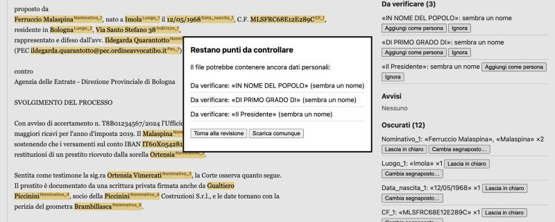

# pseudonimizzatore-web

**Italiano** · [English](README.md)

Una pagina web per pseudonimizzare documenti italiani, soprattutto giuridici, **senza
inviarli a nessuno**. Apri un documento e la pagina mostra ogni nome e ogni dato personale
che intende sostituire. Controlli le sue scelte, correggi ciò che ha sbagliato e salvi una
copia in cui le persone sono diventate etichette come `Nominativo_1`, `CF_1` o `Indirizzo_1`.

Il lavoro lo fa [pseudonimizzatore-legale](https://github.com/giovannipiccioli/pseudonimizzatore-legale),
un motore in Python che qui gira dentro la scheda del browser. Il documento non lascia mai il
tuo computer.


> [!IMPORTANT]
> Questa è **pseudonimizzazione, non anonimizzazione**. Il motore trova molto, ma non tutto.
> La pagina ti aiuta a controllare, ma la decisione di condividere il risultato resta tua.
> Un documento pseudonimizzato contiene ancora dati personali ai sensi del GDPR.

## Indice

1. [Avviare la pagina](#1-avviare-la-pagina)
2. [Un primo documento](#2-un-primo-documento)
3. [Correggere il risultato](#3-correggere-il-risultato)
4. [Salvare](#4-salvare)
5. [Documenti che legge, e limiti](#5-documenti-che-legge-e-limiti)
6. [Dove vanno i tuoi dati](#6-dove-vanno-i-tuoi-dati)
7. [Architettura](#7-architettura)
8. [Sviluppo](#8-sviluppo)
9. [Licenza](#9-licenza)

## 1. Avviare la pagina

Servono un browser recente (Chrome, Edge, Firefox o Safari) e, solo per servire la cartella,
Python 3. Scarica il repository e avvia al suo interno un piccolo server locale:

```bash
git clone https://github.com/giovannipiccioli/pseudonimizzatore-web.git
cd pseudonimizzatore-web
python3 -m http.server 8766 --bind 127.0.0.1
```

Poi apri <http://127.0.0.1:8766> nel browser. Il server serve solo perché i browser non
eseguono WebAssembly da un file aperto con un doppio clic. Distribuisce i file del tuo
computer e nient'altro.

La prima volta la pagina carica il motore (circa 7 MB, dal tuo stesso server) e dopo un
secondo circa mostra **«Motore pronto»**. Da lì in poi ogni documento richiede una frazione di
secondo.

## 2. Un primo documento

Nel repository c'è una sentenza inventata su cui provare la pagina,
[`examples/esempio_sentenza.txt`](examples/esempio_sentenza.txt). Fai clic su **Apri documento**
e aprila, oppure scegli **Prova con un esempio** nella schermata iniziale.

Il testo compare a sinistra con tre tipi di evidenziazione:

| evidenziazione | significato |
|---|---|
| **gialla**, con una piccola etichetta | sarà sostituita da quell'etichetta: `Ferruccio Malaspina` → `Nominativo_1` |
| **verde** | riconosciuta e lasciata apposta: i giudici nel loro ruolo, il numero del ricorso |
| **rosa**, *da verificare* | il controllo finale ha un dubbio: dai un'occhiata |

La stessa persona riceve la stessa etichetta ovunque. «Ferruccio Malaspina» nell'epigrafe e
«il Malaspina» nella motivazione diventano entrambi `Nominativo_1`, e la sorella citata con il
solo nome (`Ortensia`) riceve la stessa etichetta di `Ortensia Vimercati`.

Di norma il motore segue le convenzioni con cui si pubblicano le sentenze italiane:

| sostituisce | lascia in chiaro |
|---|---|
| parti, difensori, testimoni e altre persone private | i giudici, indicati nel loro ruolo (Presidente, Relatore…) |
| codici fiscali, partite IVA delle persone, IBAN e numeri di conto | gli enti pubblici (Agenzia delle Entrate, Comuni…) e gli indirizzi dei loro uffici |
| indirizzi e-mail e PEC, telefoni, documenti di identità, numeri di iscrizione ad albi | i numeri di ruolo, l'ECLI e i numeri degli atti |
| date e luoghi di nascita, indirizzi di residenza e di studio | i tribunali e gli altri nomi di luogo |
|  | le società (di norma) |

Il pannello a destra elenca tutto, in cinque sezioni:

- **Da verificare**: ciò su cui il controllo finale ti chiede di guardare, con due pulsanti.
- **Avvisi**: segnalazioni, per esempio un nome lasciato in chiaro in un punto ma non in un
  altro.
- **Oscurati**: ogni entità sostituita, la sua etichetta e quante volte compare.
- **Lasciati in chiaro**: ciò che resta, e perché.
- **Le tue modifiche**: le correzioni che hai fatto, ognuna annullabile.

## 3. Correggere il risultato

Ogni correzione si applica subito a tutto il documento, e le etichette mantengono il loro
numero.

### Qualcosa andrebbe sostituito e non lo è

Nell'esempio il «geometra Brambillasca» non ha un titolo che il motore riconosce e resta in
chiaro. **Selezionalo con il mouse** e fai clic su **Persona** nella barra **Oscura la selezione**.


Il nome diventa `Nominativo_5` ovunque compaia, in maiuscolo o in minuscolo. Se selezioni un
nome completo, vengono trovate anche le sue altre forme: il solo cognome e «COGNOME Nome». Per
un dato che non è una persona (un numero di polizza, un riferimento catastale) usa **Altro
dato** nella stessa barra, che sostituisce esattamente quel testo ovunque compaia.

### Qualcosa è sostituito e dovrebbe restare

**Fai clic sull'evidenziazione.** Un piccolo menu offre due scelte:


- **Lascia in chiaro questa occorrenza**: solo questo punto;
- **Lascia in chiaro tutta l'entità**: l'entità ovunque, per esempio un personaggio pubblico
  o una società che non è parte.

Se lasci un nome in chiaro in un punto e sostituito altrove, gli **Avvisi** lo segnalano: chi
legge potrebbe ricollegare le due cose.

### I punti da verificare

L'elenco **Da verificare** viene da un controllo finale volutamente sospettoso. Segnala tutto
ciò che sembra un nome ed è rimasto in chiaro, e quindi produce anche falsi allarmi come «IN
NOME DEL POPOLO». Per ogni voce:

- **Aggiungi come persona** se è davvero una persona;
- **Ignora** se non lo è.

Da tastiera: <kbd>n</kbd> e <kbd>p</kbd> passano alla voce successiva e precedente,
<kbd>Invio</kbd> la aggiunge come persona e <kbd>Canc</kbd> la ignora.

### Cambiare un'etichetta

Accanto a ogni entità sostituita, **Cambia segnaposto…** permette di scegliere un'altra
etichetta, per esempio `Attore_1` invece di `Nominativo_1`. Se scrivi l'etichetta di
**un'altra** entità, le due vengono unite. Serve quando la stessa persona compare in due
grafie che il motore non ha collegato, per esempio per un errore di OCR.

### Annullare

<kbd>⌘Z</kbd> annulla e <kbd>⇧⌘Z</kbd> ripete (<kbd>Ctrl</kbd> su Windows e Linux). In **Le
tue modifiche** ogni correzione ha anche il suo pulsante **Annulla**. La barra del documento
offre inoltre i pulsanti **Annulla** e **Ripeti**.

## 4. Salvare

Due pulsanti, **Scarica .txt** e **Scarica .docx**. Se resta qualcosa da verificare, la
pagina lo mostra prima e chiede conferma:



- **Da un .docx ottieni un .docx con la stessa formattazione**: stili, tabelle, intestazioni e
  immagini restano, e le etichette stanno dove c'erano i nomi. Viene tolto ciò che dice chi
  ha scritto o modificato il file: le proprietà del documento, gli autori dei commenti e delle
  revisioni, la miniatura di anteprima. Se un testo sostituito sopravvive in un punto che la
  pagina non può riscrivere, come l'indirizzo di un collegamento, la pagina dice dove e salva
  invece un .docx semplice.
- **Da .txt o .md** il .docx è semplice, un paragrafo per riga.

Il file prende il nome originale più `.pseudonimizzato`, per esempio
`ricorso.pseudonimizzato.docx`.

## 5. Documenti che legge, e limiti

**Legge**:
- `.txt`, in UTF-8 o Windows-1252;
- `.md`;
- `.docx`: corpo, intestazioni, piè di pagina, note a piè di pagina e di chiusura, commenti.

Un `.docx` con **revisioni** (modifiche rilevate) viene rifiutato. Accettale o rifiutale prima
in Word.

**Non legge**: PDF, documenti scansionati (non fa OCR), vecchi file `.doc`. Le immagini dentro
un `.docx` restano nella copia formattata ma non vengono controllate: un nome dentro
un'immagine resta.

**Quanto trova.** Il motore è nato sulle sentenze italiane. Lì elimina del tutto il 96,7%
delle identità, su un banco di prova di 124 decisioni. Su altri documenti (atti, contratti,
lettere, e-mail) un banco di prova di 31 documenti inventati dà il 95,9%. Il motore è stato
poi corretto proprio su quei documenti, quindi quel dato è ottimistico. I dettagli sono nel
[repository del motore](https://github.com/giovannipiccioli/pseudonimizzatore-legale).
**Leggi sempre il risultato.**

Le etichette si contano per documento: `Nominativo_1` in due file diversi non è la stessa
persona.

## 6. Dove vanno i tuoi dati

Da nessuna parte. La pagina scarica il suo codice una volta, dallo stesso server che la
distribuisce (la cartella `vendor/`), e poi lavora nella tua scheda. Il documento viene letto,
analizzato e riscritto dentro il browser. Puoi verificarlo nella scheda **Rete** (Network)
degli strumenti per sviluppatori: le uniche richieste vanno al server che distribuisce la
pagina, mai ad altri siti.

Non viene conservato nulla. Quando chiudi la scheda, il documento e le tue correzioni
spariscono.

## 7. Architettura

La pagina è statica (HTML, CSS e due moduli JavaScript) e il motore è in Python, eseguito nel
browser da [Pyodide](https://pyodide.org), cioè CPython compilato in WebAssembly. Pyodide vive
in un *Web Worker*, così un documento lungo non blocca mai la pagina.

```text
  pagina (thread principale)                           Web Worker
  index.html · app.css · app.js                        worker.js
 ┌────────────────────────────────┐   messaggio  ┌──────────────────────────────────┐
 │ legge il file                  │ ───────────▶ │ Pyodide (CPython in WebAssembly)  │
 │ disegna evidenziazioni/pannello│              │   bridge.py                       │
 │ tiene l'elenco delle correzioni│ ◀─────────── │     └─ pseudonimizzatore_legale   │
 │ tasti, annulla, salvataggio    │    JSON      │        (wheel in vendor/)         │
 └────────────────────────────────┘              └──────────────────────────────────┘
```

**Cosa succede quando apri un documento:**

1. La pagina legge il file. Un `.docx` passa a `bridge.docx_text`, che ne estrae il testo con
   lxml.
2. `bridge.review(testo, correzioni)` chiama il motore. `analyze` normalizza il testo, trova
   persone e dati, stabilisce chi è chi e assegna le etichette. `render` riscrive il testo una
   volta sola ed esegue il controllo finale.
3. Il bridge restituisce un JSON: il testo normalizzato, le decisioni con le loro posizioni, le
   righe del pannello, le etichette e i punti da verificare, riportati sul testo che vedi.
4. La pagina disegna evidenziazioni e pannello da quel JSON.

**Le correzioni sono un elenco, non modifiche al testo.** Ogni clic (aggiungere una persona,
lasciare in chiaro un'occorrenza, rinominare un'etichetta) aggiunge un'azione all'elenco. La
pagina traduce l'elenco negli `Edits` del motore e analizza di nuovo il documento da capo. Ci
vogliono circa 10 ms per una sentenza e circa 150 ms per un documento di 100.000 caratteri.
Annullare significa tornare all'elenco precedente. Le etichette precedenti vengono ripassate
al motore, così i numeri non cambiano sotto i tuoi occhi. Una persona che aggiungi segue
esattamente gli stessi passaggi di una trovata dal motore: altre grafie, un cognome condiviso
con qualcun altro, i conflitti con il ruolo di un giudice.

**Salvataggio.** Il `.txt` è il testo riscritto. Il `.docx` formattato viene da
`bridge.docx_pseudonymized`, che scrive le etichette nei frammenti di testo del file originale
e toglie i metadati. Quello semplice viene da `bridge.docx_bytes`.

**Regole che la tengono piccola:**

- Il motore non sa nulla della pagina. La pagina ne porta con sé una copia fissa (un wheel in
  `vendor/`), aggiornata di proposito.
- Solo `bridge.py` passa in Python. Cambiare il runtime tocca soltanto `worker.js`.
- Niente framework, npm, bundler o CDN. Ogni URL è relativo, quindi la cartella si può copiare
  così com'è dentro un sito.

**File:**

| file | ruolo |
|---|---|
| `index.html`, `app.css` | la pagina |
| `app.js` | evidenziazioni, pannello, tasti, elenco delle correzioni, salvataggio |
| `worker.js` | avvia Pyodide e chiama `bridge.py` |
| `bridge.py` | l'unico Python usato dalla pagina: `review`, `docx_text`, `docx_pseudonymized`, `docx_bytes` |
| `test_bridge.py`, `conftest.py` | test del bridge, sullo stesso motore che la pagina distribuisce |
| `vendor/` | Pyodide, `regex`, `lxml` e il motore, in versioni fissate e ospitati qui ([VENDOR.md](VENDOR.md)) |
| `build_engine_wheel.sh` | ricostruisce il wheel del motore da un tag del suo repository |
| `examples/` | un documento inventato su cui provare la pagina |
| `docs/images/` | le schermate di questo README |
| `LICENSE`, `THIRD_PARTY_NOTICES.md`, `licenses/` | licenze |

Come funziona il motore all'interno (rilevatori, identità, politiche, controllo finale) è
spiegato nel [suo ARCHITECTURE.md](https://github.com/giovannipiccioli/pseudonimizzatore-legale/blob/main/ARCHITECTURE.md).

## 8. Sviluppo

Test del bridge, con un Python normale in cui siano installati `regex` e `lxml`:

```bash
python -m pytest --doctest-modules
```

`conftest.py` mette per primo sul percorso il wheel del motore in `vendor/`, così i test
verificano lo stesso motore che la pagina carica.

Per **aggiornare il motore**, esegui `./build_engine_wheel.sh vX.Y.Z` con una copia di
`pseudonimizzatore-legale` in `../anonymizer`. Poi aggiorna `ENGINE_WHEEL` in `worker.js` e la
riga in `VENDOR.md`. Per **aggiornare Pyodide** segui `VENDOR.md`, che elenca ogni file con il
suo sha256.

## 9. Licenza

MIT, vedi [`LICENSE`](LICENSE). I file in `vendor/` mantengono le proprie licenze: MPL-2.0 per
Pyodide, PSF per CPython, Apache-2.0 per regex, BSD-3-Clause per lxml con MIT e zlib per le
sue librerie, e LGPL-2.1 per GNU libiconv. Vedi
[`THIRD_PARTY_NOTICES.md`](THIRD_PARTY_NOTICES.md).
