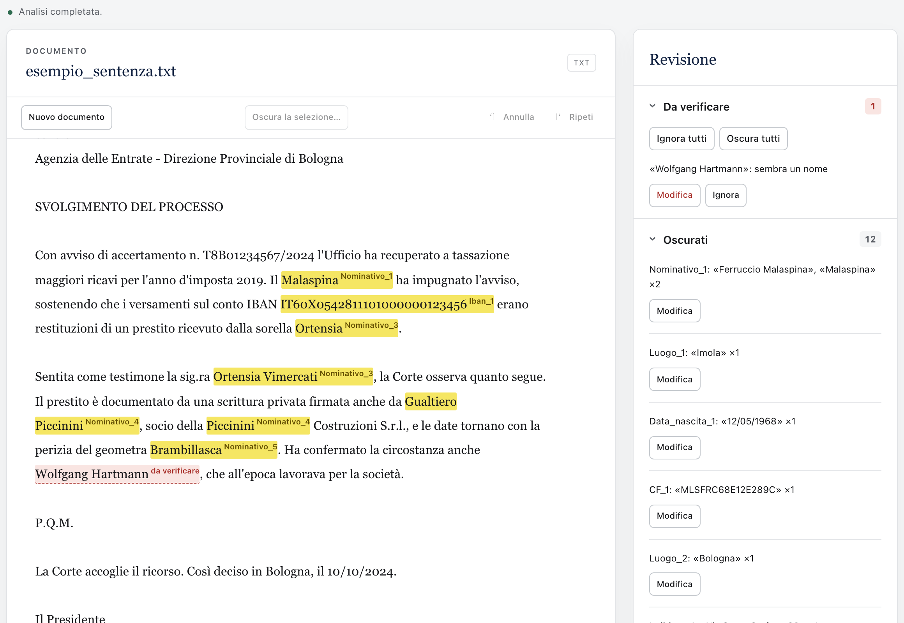

# pseudonimizzatore-web

**Italiano** · [English](README.md)

Una pagina web per pseudonimizzare documenti italiani, soprattutto giuridici, **senza
inviarli a nessuno**. Apri un documento e la pagina mostra ogni nome e ogni dato personale
che intende sostituire. Controlli le sue scelte, correggi ciò che ha sbagliato e salvi una
copia in cui le persone sono diventate etichette come `Nominativo_1`, `CF_1` o `Indirizzo_1`.

Il lavoro lo fa [pseudonimizzatore-legale](https://github.com/giovannipiccioli/pseudonimizzatore-legale),
un motore in Python che qui gira dentro la scheda del browser. Il documento non lascia mai il
tuo computer.



> [!IMPORTANT]
> Questa è **pseudonimizzazione, non anonimizzazione**. Il motore trova molto, ma non tutto.
> La pagina ti aiuta a controllare, ma la decisione di condividere il risultato resta tua.
> Un documento pseudonimizzato contiene ancora dati personali ai sensi del GDPR.

## Indice

1. [Avviare la pagina](#1-avviare-la-pagina)
2. [Un primo documento](#2-un-primo-documento)
3. [Correggere il risultato](#3-correggere-il-risultato)
4. [Salvare](#4-salvare)
5. [Documenti che legge, e limiti](#5-documenti-che-legge-e-limiti)
6. [Dove vanno i tuoi dati](#6-dove-vanno-i-tuoi-dati)
7. [Architettura](#7-architettura)
8. [Sviluppo](#8-sviluppo)
9. [Licenza](#9-licenza)

## 1. Avviare la pagina

Servono un browser recente (Chrome, Edge, Firefox o Safari) e, solo per servire la cartella,
Python 3. Scarica il repository e avvia al suo interno un piccolo server locale:

```bash
git clone https://github.com/giovannipiccioli/pseudonimizzatore-web.git
cd pseudonimizzatore-web
python3 -m http.server 8766 --bind 127.0.0.1
```

Poi apri <http://127.0.0.1:8766> nel browser. Il server serve solo perché i browser non
eseguono WebAssembly da un file aperto con un doppio clic. Distribuisce i file del tuo
computer e nient'altro.

La prima volta la pagina carica il motore (circa 7 MB, dal tuo stesso server) e dopo un
secondo circa abilita i comandi del documento. Da lì in poi ogni documento richiede una frazione di
secondo.

## 2. Un primo documento

Scrivi o incolla in **Testo da analizzare**, trascina nel riquadro un file .txt, .md, .docx o .pdf,
oppure scegli **Apri documento**. Il testo importato compare nel riquadro prima dell’analisi.
**Prova con un esempio** carica una [sentenza inventata](examples/esempio_sentenza.txt).
Scegli **Analizza testo** per iniziare la revisione o **Nuovo documento** per ricominciare.

Il testo compare a sinistra con tre tipi di evidenziazione:

| evidenziazione | significato |
|---|---|
| **gialla**, con una piccola etichetta | sarà sostituita da quell'etichetta: `Ferruccio Malaspina` → `Nominativo_1` |
| **verde** | riconosciuta e lasciata apposta: i giudici nel loro ruolo, il numero del ricorso |
| **rosa**, *da verificare* | il controllo finale ha un dubbio: dai un'occhiata |

La stessa persona riceve la stessa etichetta ovunque. «Ferruccio Malaspina» nell'epigrafe e
«il Malaspina» nella motivazione diventano entrambi `Nominativo_1`, e la sorella citata con il
solo nome (`Ortensia`) riceve la stessa etichetta di `Ortensia Vimercati`.

Per le sentenze italiane la pagina usa il motore con `keep_roles=("giudice",)`:

| sostituisce | lascia in chiaro |
|---|---|
| parti, difensori, testimoni e altre persone private | i giudici, indicati nel loro ruolo (Presidente, Relatore…) |
| codici fiscali, partite IVA delle persone, IBAN e numeri di conto | gli enti pubblici (Agenzia delle Entrate, Comuni…) e gli indirizzi dei loro uffici |
| indirizzi e-mail e PEC, telefoni, documenti di identità, numeri di iscrizione ad albi | i numeri di ruolo, l'ECLI e i numeri degli atti |
| date e luoghi di nascita, indirizzi di residenza e di studio | i tribunali e gli altri nomi di luogo |
|  | le società (di norma) |

Il pannello a destra elenca tutto, in cinque sezioni:

- **Da verificare** elenca i passi segnalati dal controllo finale.
- **Avvisi**: segnalazioni, per esempio un nome lasciato in chiaro in un punto ma non in un
  altro.
- **Oscurati**: ogni entità sostituita, la sua etichetta e quante volte compare.
- **Lasciati in chiaro**: ciò che resta, e perché.
- **Modifiche**: le correzioni che hai fatto, ognuna annullabile.

## 3. Correggere il risultato

Le correzioni si applicano subito e le etichette mantengono il loro numero.

### Qualcosa andrebbe sostituito e non lo è

Seleziona il testo che vuoi oscurare, per esempio «Wolfgang Hartmann» nella
sentenza di esempio. Si apre un menu accanto alla selezione. Puoi aprirlo anche con
**Oscura la selezione…** nella barra del documento.

- **Solo questa occorrenza** sostituisce il passaggio selezionato. Le altre occorrenze
  mantengono il trattamento già previsto. Per una nuova selezione il motore usa
  un segnaposto `Dato`.
- **Tutte le occorrenze dello stesso testo** cerca quel testo in tutto il documento anche
  se cambiano maiuscole o spazi. È utile per riferimenti e altri dati letterali.
- **Persona e varianti del nome** cerca la stessa persona, anche nelle forme riconosciute
  dal motore, come il solo cognome o «COGNOME Nome» quando selezioni un nome completo.

### Rivedere un’evidenziazione o una voce del pannello

Fai clic su un passaggio giallo, verde o rosa oppure su **Modifica** nel pannello laterale.
Si apre lo stesso modulo. Nel documento la scelta iniziale è **Solo questa occorrenza**.
Per una voce raggruppata del pannello è **Tutta l’entità**. Puoi passare a una sola
occorrenza e riconoscerla dal testo circostante.

- Scegli **Oscura** o **Lascia in chiaro**. Per oscurare puoi scrivere l’etichetta nel
  campo **Segnaposto**. Una scelta per tutta l’entità aggiorna anche le sue occorrenze
  già modificate singolarmente.
- Per un punto **Da verificare**, puoi oscurare solo quel passo, tutte le copie dello
  stesso testo oppure la persona e le varianti del nome. **Ignora segnalazione** chiude quel rilievo.
- **Oscura tutti** in **Da verificare** oscura i passi elencati con segnaposti automatici.
  **Ignora tutti** chiude le segnalazioni lasciando il testo in chiaro. Se un passo non è identificabile
  in modo univoco, o se l’oscuramento si sovrappone a una scelta esistente, va trattato
  singolarmente. **Annulla** ripristina tutte le scelte del gruppo in un solo passaggio.
- Per riutilizzare un’etichetta esistente solo in quel passo, scegli **Collega questa occorrenza**.
  Per unire due persone o due dati, seleziona tutta l’entità, inserisci l’altra etichetta
  e conferma con **Unisci le due entità**.

Il pannello riepiloga le grafie, il numero di occorrenze, gli avvisi e la cronologia.
Se lasci un nome in chiaro in un punto e lo oscuri altrove, **Avvisi** segnala che chi
legge potrebbe ricollegarli. Usa **n** e **p** per spostarti tra le segnalazioni,
**Invio** per accettare la categoria suggerita e **Canc** per ignorare la segnalazione.

### Annullare

<kbd>⌘Z</kbd> annulla e <kbd>⇧⌘Z</kbd> ripete (<kbd>Ctrl</kbd> su Windows e Linux). In **Le
tue modifiche** ogni correzione ha anche il suo pulsante **Annulla**. La barra del documento
offre inoltre i pulsanti **Annulla** e **Ripeti**.

## 4. Salvare

Due pulsanti, **Salva .txt** e **Salva .docx**. Se resta qualcosa da verificare, la
pagina lo mostra prima e chiede conferma:


- **Il .docx importato conserva la formattazione se il testo di partenza è invariato**: stili, tabelle, intestazioni e
  immagini restano, e le etichette stanno dove c'erano i nomi. Viene tolto ciò che dice chi
  ha scritto o modificato il file: le proprietà del documento, gli autori dei commenti e delle
  revisioni, la miniatura di anteprima. Se un testo sostituito sopravvive in un punto che la
  pagina non può riscrivere, come l'indirizzo di un collegamento, la pagina dice dove e salva
  invece un .docx semplice.
- **Da PDF, .txt, .md e testo scritto, incollato o modificato** il .docx è semplice, un paragrafo per riga.

Il file prende il nome originale più `.pseudonimizzato`, per esempio
`ricorso.pseudonimizzato.docx`.

## 5. Documenti che legge, e limiti

**Legge**:
- `.txt`, in UTF-8 o Windows-1252;
- `.md`;
- `.docx`: corpo, intestazioni, piè di pagina, note a piè di pagina e di chiusura, commenti.
- `.pdf`: testo incorporato, nell’ordine delle pagine. La pagina segnala i numeri delle
  pagine senza testo estraibile. Il risultato si scarica in `.txt` o `.docx` semplice.

Un `.docx` con **revisioni** (modifiche rilevate) viene rifiutato. Accettale o rifiutale prima
in Word.

Per le scansioni serve una copia con testo selezionabile. Per i PDF protetti, apri una
copia senza protezione. I file `.doc` si possono prima convertire in `.docx`. Le immagini
dentro un `.docx` restano nella copia formattata e sono escluse dalla revisione del testo.

**Quanto trova.** Il motore è nato sulle sentenze italiane. Lì elimina del tutto il 96,7%
delle identità, su un banco di prova di 124 decisioni. Su altri documenti (atti, contratti,
lettere, e-mail) un banco di prova di 31 documenti inventati dà il 95,9%. Il motore è stato
poi corretto proprio su quei documenti, quindi quel dato è ottimistico. I dettagli sono nel
[repository del motore](https://github.com/giovannipiccioli/pseudonimizzatore-legale).
**Leggi sempre il risultato.**

Le etichette si contano per documento: `Nominativo_1` in due file diversi non è la stessa
persona.

## 6. Dove vanno i tuoi dati

Da nessuna parte. La pagina scarica il suo codice una volta, dallo stesso server che la
distribuisce (la cartella `vendor/`), e poi lavora nella tua scheda. Il documento viene letto,
analizzato e riscritto dentro il browser. Puoi verificarlo nella scheda **Rete** (Network)
degli strumenti per sviluppatori: le uniche richieste vanno al server che distribuisce la
pagina, mai ad altri siti.

Non viene conservato nulla. Quando chiudi la scheda, il documento e le tue correzioni
spariscono.

## 7. Architettura

La pagina è statica (HTML, CSS e due moduli JavaScript) e il motore è in Python, eseguito nel
browser da [Pyodide](https://pyodide.org), cioè CPython compilato in WebAssembly. Pyodide vive
in un *Web Worker*, così un documento lungo non blocca mai la pagina.

```text
  pagina (thread principale)                           Web Worker
  index.html · app.css · app.js                        worker.js
 ┌────────────────────────────────┐   messaggio  ┌──────────────────────────────────┐
 │ legge il file                  │ ───────────▶ │ Pyodide (CPython in WebAssembly)  │
 │ disegna evidenziazioni/pannello│              │   bridge.py                       │
 │ tiene l'elenco delle correzioni│ ◀─────────── │     └─ pseudonimizzatore_legale   │
 │ tasti, annulla, salvataggio    │    JSON      │        (wheel in vendor/)         │
 └────────────────────────────────┘              └──────────────────────────────────┘
```

**Cosa succede quando apri un documento:**

1. La pagina legge il file. Un `.docx` passa a `bridge.docx_text`, che ne estrae il testo con
   lxml. Un `.pdf` passa a `bridge.pdf_text`, che estrae il testo con pypdf nel worker.
2. `bridge.review(testo)` chiama il motore. `analyze` normalizza il testo, trova
   persone e dati, stabilisce chi è chi e assegna le etichette. `render` riscrive il testo una
   volta sola ed esegue il controllo finale.
3. Il bridge restituisce un JSON: il testo normalizzato, le decisioni con le loro posizioni, le
   righe del pannello, le etichette e i punti da verificare, riportati sul testo che vedi.
4. La pagina disegna evidenziazioni e pannello da quel JSON.

La pagina conserva in memoria il `report.state` del documento aperto. Una rinomina cambia
il segnaposto della persona o del dato. Per lasciare in chiaro un solo punto o ignorare una
segnalazione, il motore registra il passo con il suo contesto. All’analisi successiva riceve
lo stato completo, compreso il riferimento alla versione del testo. Sullo stesso testo, lo
stesso stato riproduce la stessa copia. Annulla ripristina lo stato precedente. Se si annulla
una correzione intermedia, la pagina riapplica le scelte successive ancora pertinenti.

**Salvataggio.** Il `.txt` è il testo riscritto. Il `.docx` formattato viene da
`bridge.docx_pseudonymized`, che scrive le etichette nei frammenti di testo del file originale
e toglie i metadati. Quello semplice viene da `bridge.docx_bytes`.

**Regole che la tengono piccola:**

- Il motore non sa nulla della pagina. La pagina ne porta con sé una copia fissa (un wheel in
  `vendor/`), aggiornata di proposito.
- Solo `bridge.py` passa in Python. Cambiare il runtime tocca soltanto `worker.js`.
- Niente framework, npm, bundler o CDN. Ogni URL è relativo, quindi la cartella si può copiare
  così com'è dentro un sito.

**File:**

| file | ruolo |
|---|---|
| `index.html`, `app.css` | la pagina |
| `app.js` | evidenziazioni, pannello, tasti, elenco delle correzioni, salvataggio |
| `worker.js` | avvia Pyodide e chiama `bridge.py` |
| `bridge.py` | l'unico Python usato dalla pagina: `review`, `pdf_text`, `docx_text`, `docx_pseudonymized`, `docx_bytes` |
| `test_bridge.py`, `conftest.py` | test del bridge, sullo stesso motore che la pagina distribuisce |
| `vendor/` | Pyodide, `regex`, `lxml`, `pypdf` e il motore, in versioni fissate e ospitati qui ([VENDOR.md](VENDOR.md)) |
| `build_engine_wheel.sh` | ricostruisce il wheel del motore da un tag del suo repository |
| `examples/` | un documento inventato su cui provare la pagina |
| `docs/images/` | le schermate di questo README |
| `LICENSE`, `THIRD_PARTY_NOTICES.md`, `licenses/` | licenze |

Come funziona il motore all'interno (rilevatori, identità, politiche, controllo finale) è
spiegato nel [suo ARCHITECTURE.md](https://github.com/giovannipiccioli/pseudonimizzatore-legale/blob/main/ARCHITECTURE.md).

## 8. Sviluppo

Quando modifichi `app.js`, `worker.js` o `bridge.py`, incrementa il numero `?v=`
di `app.js` in `index.html`. I tre file condividono quella versione nell’indirizzo,
così dopo un aggiornamento il browser carica file compatibili tra loro.

Test del bridge, con un Python normale in cui siano installati `regex` e `lxml`:

```bash
python -m pytest --doctest-modules
```

`conftest.py` mette per primo sul percorso i wheel del motore e di pypdf in `vendor/`, così i test
verificano le stesse versioni del motore e dell’importatore PDF usate dalla pagina.

Il browser carica il wheel del motore da `vendor/`. Le modifiche in `../anonymizer`
arrivano all’app web quando ricostruisci e distribuisci quel wheel:

1. Esegui `./build_engine_wheel.sh vX.Y.Z` in questa repo, con una copia di
   `pseudonimizzatore-legale` in `../anonymizer`. Usa una nuova versione per le release.
   Per una prova locale, ometti il tag per compilare dalla copia di lavoro del motore.
2. Aggiorna `ENGINE_WHEEL` in `worker.js` se cambia il nome del file, e aggiorna versione
   e SHA-256 in `VENDOR.md`.
3. Esegui i test del bridge e prova un documento nel browser. Al rilascio, committa il
   wheel e le modifiche correlate in questa repo. Se è cambiata l’API pubblica del
   motore, aggiorna anche `bridge.py` e i relativi test.

Per **aggiornare Pyodide** segui `VENDOR.md`, che elenca ogni file con il suo SHA-256.

## 9. Licenza

MIT, vedi [`LICENSE`](LICENSE). I file in `vendor/` mantengono le proprie licenze: MPL-2.0 per
Pyodide, PSF per CPython, Apache-2.0 per regex, BSD-3-Clause per pypdf e lxml con MIT e zlib per le
sue librerie, e LGPL-2.1 per GNU libiconv. Vedi
[`THIRD_PARTY_NOTICES.md`](THIRD_PARTY_NOTICES.md).
