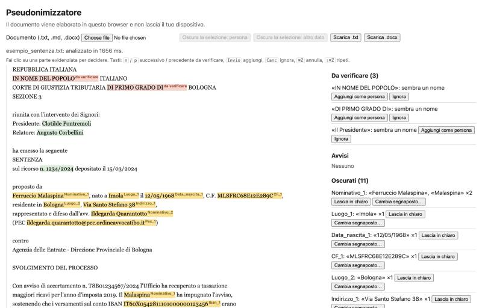
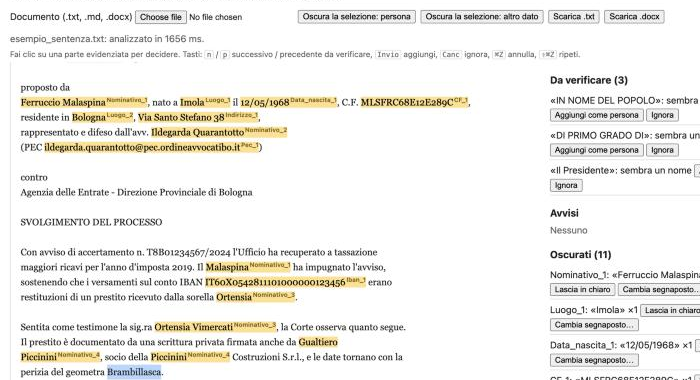
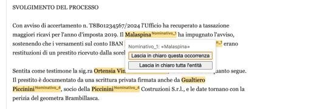
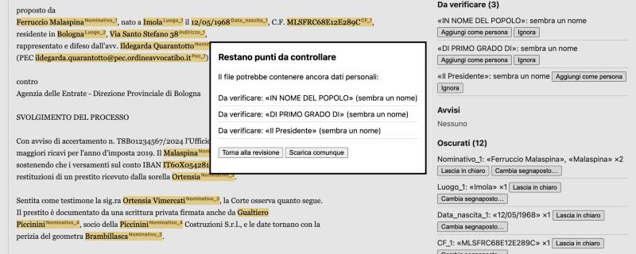

# pseudonimizzatore-web

[Italiano](README.it.md) · **English**

A web page for pseudonymizing Italian documents, legal ones above all, **without sending them
anywhere**. Open a document and the page shows every name and piece of personal data it
would replace. Check its choices, correct what it got wrong, and save a copy in which people
have become tags such as `Nominativo_1`, `CF_1` or `Indirizzo_1`.

The work is done by [pseudonimizzatore-legale](https://github.com/giovannipiccioli/pseudonimizzatore-legale),
a Python engine that here runs inside the browser tab. The document never leaves your computer.



> [!IMPORTANT]
> This is **pseudonymization, not anonymization**. The engine finds a lot, but not everything.
> The page helps you check, and the decision to share the result is yours. A pseudonymized
> document is still personal data under the GDPR.

## Contents

1. [Start the page](#1-start-the-page)
2. [A first document](#2-a-first-document)
3. [Correcting the result](#3-correcting-the-result)
4. [Saving](#4-saving)
5. [Documents it reads, and its limits](#5-documents-it-reads-and-its-limits)
6. [Where your data goes](#6-where-your-data-goes)
7. [Architecture](#7-architecture)
8. [Development](#8-development)
9. [Licence](#9-licence)

## 1. Start the page

You need a recent browser (Chrome, Edge, Firefox or Safari) and, only to serve the folder,
Python 3. Download the repository and start a small local server inside it:

```bash
git clone https://github.com/giovannipiccioli/pseudonimizzatore-web.git
cd pseudonimizzatore-web
python3 -m http.server 8766 --bind 127.0.0.1
```

Then open <http://127.0.0.1:8766> in the browser. The server is needed only because browsers
refuse to run WebAssembly from a file opened with a double click. It serves the files on your
own computer and nothing else.

The first time, the page loads the engine (about 7 MB, from your own server) and in a second
or so says **"Motore pronto"**. From then on, each document takes a fraction of a second.

## 2. A first document

The repository includes an invented decision to try the page on,
[`examples/esempio_sentenza.txt`](examples/esempio_sentenza.txt). Click **Choose file**
(**Scegli file**) and open it.

The text appears on the left with three kinds of highlight:

| highlight | meaning |
|---|---|
| **yellow**, with a small tag | will be replaced by that tag: `Ferruccio Malaspina` → `Nominativo_1` |
| **green** | recognised and kept on purpose: the judges in their role, the case number |
| **pink**, *da verificare* | the final check is unsure: take a look |

The same person gets the same tag everywhere. "Ferruccio Malaspina" in the heading and "il
Malaspina" in the body both become `Nominativo_1`, and the sister mentioned by first name
alone (`Ortensia`) gets the same tag as `Ortensia Vimercati`.

By default the engine follows the conventions for publishing Italian court decisions:

| replaced | kept |
|---|---|
| parties, counsel, witnesses and other private persons | judges, named in their role (Presidente, Relatore…) |
| codici fiscali, VAT numbers of individuals, IBANs and account numbers | public bodies (Agenzia delle Entrate, Comuni…) and their offices' addresses |
| e-mail and PEC addresses, phone numbers, ID documents, register numbers | case numbers, ECLI and the numbers of acts |
| dates and places of birth, residence and studio addresses | courts and other place names |
|  | companies (by default) |

The panel on the right lists everything, in five sections:

- **Da verificare**: what the final check would have you look at, with two buttons.
- **Avvisi**: warnings, for example a name you kept in one place but not in another.
- **Oscurati**: every replaced entity, its tag and how many times it appears.
- **Lasciati in chiaro**: what is kept, and why.
- **Le tue modifiche**: the corrections you have made, each one undoable.

## 3. Correcting the result

Each correction is applied at once to the whole document, and the tags keep their numbers.

### Something should be replaced but isn't

In the example, the surveyor "geometra Brambillasca" has no title the engine recognises and
stays in clear. **Select it with the mouse** and click **Oscura la selezione: persona**
("redact the selection: person").



The name becomes `Nominativo_5` everywhere it appears, in capitals or not. Select a full
name and its other forms are found too: the surname alone and "SURNAME Name". For data that
is not a person (a policy number, a cadastral reference) use **Oscura la selezione: altro
dato** ("redact the selection: other data"). That replaces exactly that text wherever it
appears.

### Something is replaced but should stay

**Click the highlight.** A small menu offers two choices:



- **Lascia in chiaro questa occorrenza**: keep only this occurrence;
- **Lascia in chiaro tutta l'entità**: keep the whole entity everywhere, for example a
  public figure or a company that is not a party.

If you keep a name in one place and leave it replaced elsewhere, **Avvisi** says so: a
reader could connect the two.

### Points to check

The **Da verificare** list comes from a deliberately suspicious final check. It flags
anything that looks like a name and is still in clear, so it also raises false alarms such as
"IN NOME DEL POPOLO". For each item:

- **Aggiungi come persona** if it really is a person;
- **Ignora** if it isn't.

From the keyboard: <kbd>n</kbd> and <kbd>p</kbd> move to the next and previous item,
<kbd>Invio</kbd> (Enter) adds it as a person, and <kbd>Canc</kbd> (Delete) ignores it.

### Changing a tag

Next to each replaced entity, **Cambia segnaposto…** lets you choose another tag, for
example `Attore_1` instead of `Nominativo_1`. If you type the tag of **another** entity, the
two merge into one. That is useful when the same person appears in two spellings the engine
did not connect, for example an OCR typo.

### Undo

<kbd>⌘Z</kbd> undoes and <kbd>⇧⌘Z</kbd> redoes (<kbd>Ctrl</kbd> on Windows and Linux). In
**Le tue modifiche**, each correction also has its own **Annulla** (undo) button.

## 4. Saving

Two buttons, **Scarica .txt** and **Scarica .docx**. If something is still on the list to
check, the page shows it first and asks for confirmation:



- **From a .docx you get a .docx with the same formatting**: styles, tables, headers and
  images stay, and the tags sit where the names were. What says who wrote or edited the file
  is removed: document properties, comment authors, revision authors, the preview thumbnail.
  If a replaced text survives somewhere the page cannot rewrite, such as a link address, the
  page says where and saves a plain .docx instead.
- **From .txt or .md** the .docx is plain, one paragraph per line.

The file takes the original name plus `.pseudonimizzato`, for example
`ricorso.pseudonimizzato.docx`.

## 5. Documents it reads, and its limits

**It reads**:
- `.txt`, in UTF-8 or Windows-1252;
- `.md`;
- `.docx`: body, headers, footers, footnotes and endnotes, comments.

A `.docx` with **tracked changes** is refused. Accept or reject them in Word first.

**It does not read**: PDF, scanned documents (it does not do OCR), old `.doc` files. The
images inside a `.docx` are kept in the formatted copy but are not checked: a name inside an
image stays.

**How much it finds.** The engine was built on Italian court decisions. There, it fully
removes 96.7% of identities on a benchmark of 124 decisions. On other documents (briefs,
contracts, letters, e-mails) a benchmark of 31 invented documents gives 95.9%. The engine
was then corrected on those same documents, so that figure is optimistic. The details are in
[the engine's repository](https://github.com/giovannipiccioli/pseudonimizzatore-legale).
**Always read the result.**

Tags are counted per document: `Nominativo_1` in two different files are not the same
person.

## 6. Where your data goes

Nowhere. The page downloads its code once, from the same server that serves it (the
`vendor/` folder), and then works offline in your tab. The document is read, analysed and
rewritten inside the browser. You can check this in the developer tools' **Network** tab:
the only requests go to the server that serves the page, never to another site.

Nothing is stored. When you close the tab, the document and your corrections are gone.

## 7. Architecture

The page is static (HTML, CSS and two JavaScript modules) and the engine is Python, run in
the browser by [Pyodide](https://pyodide.org), CPython compiled to WebAssembly. Pyodide lives
in a *Web Worker*, so a long document never freezes the page.

```text
  page (main thread)                                  Web Worker
  index.html · app.css · app.js                       worker.js
 ┌────────────────────────────────┐   message    ┌──────────────────────────────────┐
 │ reads the file                 │ ───────────▶ │ Pyodide (CPython in WebAssembly)  │
 │ draws highlights and panel     │              │   bridge.py                       │
 │ keeps the list of corrections  │ ◀─────────── │     └─ pseudonimizzatore_legale   │
 │ handles keys, undo, saving     │    JSON      │        (wheel in vendor/)         │
 └────────────────────────────────┘              └──────────────────────────────────┘
```

**What happens when you open a document:**

1. The page reads the file. A `.docx` goes to `bridge.docx_text`, which extracts the text
   with lxml.
2. `bridge.review(text, corrections)` calls the engine. `analyze` normalizes the text,
   finds people and data, resolves who is who and assigns the tags. `render` rewrites the
   text once and runs the final check.
3. The bridge returns JSON: the normalized text, the decisions with their positions, the
   panel rows, the tags, and the points to check, mapped back onto the text you see.
4. The page draws the highlights and the panel from that JSON.

**Corrections are a list, not edits to the text.** Every click (add a person, keep an
occurrence, rename a tag) appends an action to the list. The page turns the list into the
engine's `Edits` and analyses the document again from scratch. That takes about 10 ms for a
decision and about 150 ms for a 100,000-character document. Undo means going back to the
previous list. The previous tags are passed back in, so the numbers do not change under your
eyes. A person you add goes through exactly the same steps as one the engine found: other
spellings, a surname shared with someone else, conflicts with a judge's role.

**Saving.** The `.txt` is the rewritten text. The formatted `.docx` comes from
`bridge.docx_pseudonymized`, which writes the tags into the original file's text runs and
removes the metadata. The plain one comes from `bridge.docx_bytes`.

**Rules that keep it small:**

- The engine knows nothing about the page. The page carries a fixed copy of it (a wheel in
  `vendor/`), updated on purpose.
- Only `bridge.py` crosses into Python. Changing the runtime touches `worker.js` alone.
- No framework, npm, bundler or CDN. Every URL is relative, so the folder can be copied
  as-is into a website.

**Files:**

| file | role |
|---|---|
| `index.html`, `app.css` | the page |
| `app.js` | highlights, panel, keys, the list of corrections, saving |
| `worker.js` | starts Pyodide and calls `bridge.py` |
| `bridge.py` | the only Python the page uses: `review`, `docx_text`, `docx_pseudonymized`, `docx_bytes` |
| `test_bridge.py`, `conftest.py` | tests of the bridge, against the same engine the page ships |
| `vendor/` | Pyodide, `regex`, `lxml` and the engine, pinned and self-hosted ([VENDOR.md](VENDOR.md)) |
| `build_engine_wheel.sh` | rebuilds the engine wheel from a tag of its repository |
| `examples/` | an invented document to try the page on |
| `docs/images/` | the screenshots in this README |
| `LICENSE`, `THIRD_PARTY_NOTICES.md`, `licenses/` | licences |

How the engine works inside (detectors, identities, policy, final check) is explained in
[its ARCHITECTURE.md](https://github.com/giovannipiccioli/pseudonimizzatore-legale/blob/main/ARCHITECTURE.md).

## 8. Development

Bridge tests, under ordinary Python with `regex` and `lxml` installed:

```bash
python -m pytest --doctest-modules
```

`conftest.py` puts the engine wheel from `vendor/` first on the path, so the tests check the
same engine the page loads.

To **update the engine**, run `./build_engine_wheel.sh vX.Y.Z` with a sibling checkout of
`pseudonimizzatore-legale` in `../anonymizer`. Then change `ENGINE_WHEEL` in `worker.js` and
the row in `VENDOR.md`. To **update Pyodide**, follow `VENDOR.md`, which lists each file with
its sha256.

## 9. Licence

MIT, see [`LICENSE`](LICENSE). The files in `vendor/` keep their own licences: MPL-2.0 for
Pyodide, PSF for CPython, Apache-2.0 for regex, BSD-3-Clause for lxml with MIT and zlib for
its libraries, and LGPL-2.1 for GNU libiconv. See
[`THIRD_PARTY_NOTICES.md`](THIRD_PARTY_NOTICES.md).
